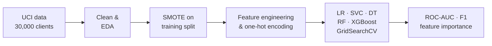
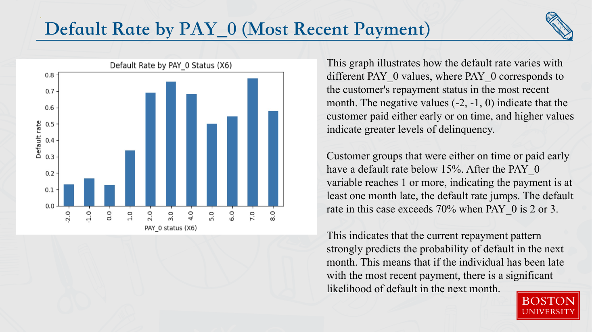
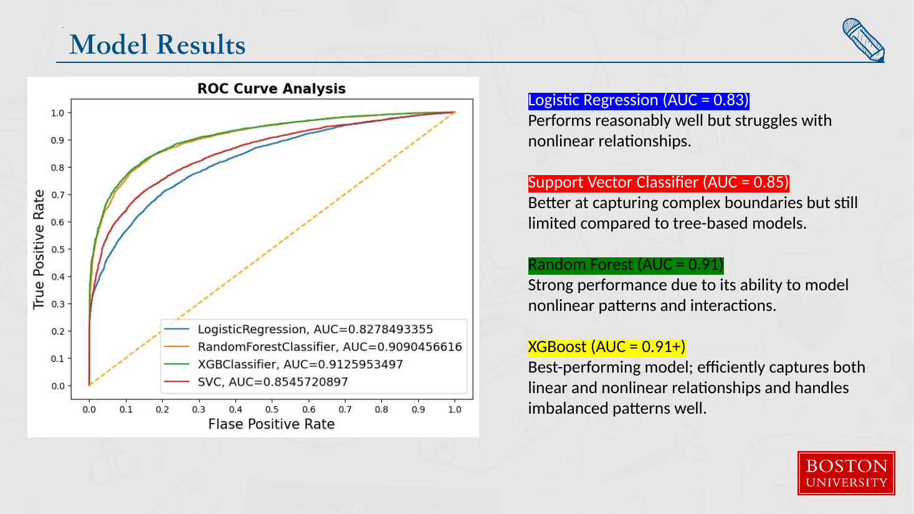
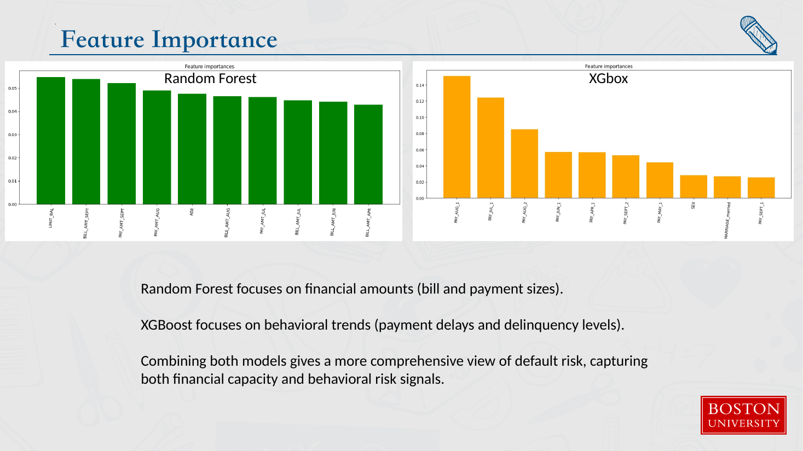
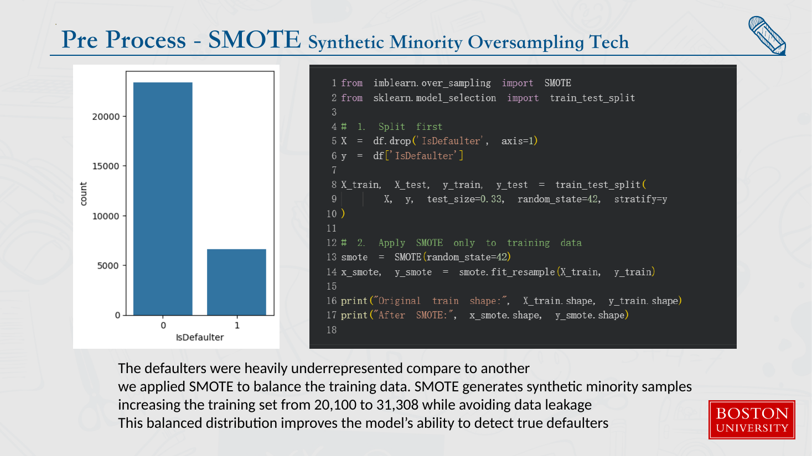

<div align="center">

# Credit Card Default Prediction

**BA810 · Supervised Machine Learning**<br>
Boston University · Questrom School of Business · MS in Business Analytics · Fall 2025


*Can a bank tell, from six months of billing and repayment history, which cardholders will default next month?*

</div>

## At a glance

- **Imbalanced target:** 6,636 of 30,000 clients (22.1%) defaulted in the following month.
- **Recent repayment status dominates:** clients who paid on time or early default at under 15%, but once the latest payment is 2–3 months late the default rate exceeds 70%.
- **SMOTE** grew the training split from 20,100 to 31,308 rows, giving the minority (default) class equal weight.
- **Tree ensembles win:** ROC-AUC was 0.83 for Logistic Regression, 0.85 for SVC, 0.91 for Random Forest and 0.913 for tuned XGBoost.
- **Best model (XGBoost):** test accuracy 0.836 and F1 0.830, against 0.750 and 0.732 for the Logistic Regression baseline.

## The question

Card issuers lose money when a customer stops paying, and they usually react only after the first missed payment. If a model can flag high-risk cardholders a month ahead, risk teams can send reminders, lower limits or start a manual review before the loss happens. The project compares four supervised classifiers on this task. Because missed defaulters are the costly error, it judges them on recall, F1 and ROC-AUC rather than accuracy alone.

## Data

| Source | Size (rows/period) | What we used it for |
|---|---|---|
| [UCI ML Repository: Default of Credit Card Clients](https://archive.ics.uci.edu/dataset/350/default+of+credit+card+clients) (Yeh & Lien, 2009; CC BY 4.0) | 30,000 clients of a Taiwanese bank, 25 columns, April–September 2005 | Demographics (sex, education, marriage, age), credit limit, 6 months of repayment status (`PAY_0`–`PAY_6`), bill amounts and payment amounts; target = default next month |

A copy of the raw CSV is in [`data/`](data/default_of_credit_card_clients.csv) (2.7 MB). It has no missing values.

## Approach

1. **Clean:** fold the undocumented codes EDUCATION 0/5/6 into "others" and MARRIAGE 0 into "others", and rename the monthly columns (e.g. `PAY_0` → `PAY_SEPT`).
2. **Explore:** look at the class balance, default rates by demographic group, credit limit and age by class, and the bill/payment trends over the six months.
3. **Rebalance:** do a stratified train/test split, then apply SMOTE to the training split only (20,100 → 31,308 rows).
4. **Engineer:** add `Payement_Value` (sum of the six repayment-status codes) and `Dues` (total billed minus total paid), one-hot encode education, marriage and repayment status, and standardize features for LR and SVC.
5. **Model and tune:** fit Logistic Regression, SVC (RBF), Decision Tree, Random Forest and XGBoost, tuning each with `GridSearchCV` (3-fold).
6. **Evaluate:** compare accuracy, F1 and ROC-AUC on a 33% hold-out, plot the ROC curves together and read the feature importances.



## Results

<table>
<tr>
<td width="50%"></td>
<td width="50%"></td>
</tr>
<tr>
<td><sub>Default rate rises steeply once the most recent payment (<code>PAY_0</code>) is a month or more late.</sub></td>
<td><sub>ROC curves on the hold-out set: XGBoost (AUC 0.913) and Random Forest (0.909) lead SVC (0.855) and Logistic Regression (0.828).</sub></td>
</tr>
<tr>
<td></td>
<td></td>
</tr>
<tr>
<td><sub>Random Forest leans on bill and payment amounts, while XGBoost leans on delinquency status (how late payments are).</sub></td>
<td><sub>The class distribution before SMOTE, and the code that rebalanced the training split.</sub></td>
</tr>
</table>

Hold-out metrics as reported in the notebook's model comparison table:

| Model | Train accuracy | Test accuracy | F1 | ROC-AUC |
|---|---|---|---|---|
| Logistic Regression | 0.755 | 0.750 | 0.732 | 0.828 |
| SVC (RBF, C=10) | 0.814 | 0.780 | 0.763 | 0.855 |
| Random Forest (150 trees, depth 30) | 0.999 | 0.832 | 0.827 | 0.909 |
| **XGBoost (tuned)** | 0.945 | **0.836** | **0.830** | **0.913** |

> **Caveats.** The models were trained and tested on a re-split of the SMOTE-balanced data, so the hold-out set contains synthetic minority samples. Expect lower scores on the original, imbalanced class mix. In the notebook, the per-model precision and recall calls pass `(predicted, actual)` in reverse order, so the "precision" and "recall" columns are swapped. F1 and ROC-AUC are not affected. Random Forest's near-perfect training accuracy points to overfitting.

From the business side, the deck proposes Low/Medium/High risk tiers, with automated reminders or limit reviews for the high tier. It also proposes ongoing monitoring of recall, AUC and input drift, with retraining every 3–6 months.

## Deliverables

| File | Description |
|---|---|
| [`deliverables/BA810_Team05_Final_Presentation.pdf`](deliverables/BA810_Team05_Final_Presentation.pdf) | Final presentation (20 slides), presented December 2025 |
| [`deliverables/BA810_Team05_Final_Presentation.pptx`](deliverables/BA810_Team05_Final_Presentation.pptx) | Original PowerPoint version of the deck |
| [`notebooks/credit_card_default_prediction.ipynb`](notebooks/credit_card_default_prediction.ipynb) | Final Colab notebook with all outputs: EDA, SMOTE, feature engineering, model tuning and comparison |
| [`data/default_of_credit_card_clients.csv`](data/default_of_credit_card_clients.csv) | Raw UCI dataset (30,000 rows) |

## Repository layout

```text
.
├── README.md
├── LICENSE
├── .gitignore
├── assets/                  # slide renders used in this README
│   ├── cover.png
│   ├── default_rate_by_pay0.png
│   ├── feature_importance.png
│   ├── model_results_roc.png
│   └── smote.png
├── data/
│   └── default_of_credit_card_clients.csv
├── deliverables/
│   ├── BA810_Team05_Final_Presentation.pdf
│   └── BA810_Team05_Final_Presentation.pptx
└── notebooks/
    └── credit_card_default_prediction.ipynb
```

## Reproduce

- **Environment:** Google Colab, or any Python 3 setup with `pandas`, `numpy`, `matplotlib`, `seaborn`, `scikit-learn`, `imbalanced-learn`, `xgboost`, `lightgbm` and `torch` (`torch` is used only to save and reload the fitted models).
- **Data:** the first cell clones a team member's public repo ([github.com/ply00/810](https://github.com/ply00/810)) and reads `default of credit card clients cleaned.csv`. That file is the UCI data with the target column named `default.payment.next.month`. To run offline, point the path to `data/default_of_credit_card_clients.csv` and rename `default payment next month` to `default.payment.next.month`.
- **Run:** open the notebook in Colab (or Jupyter) and run all cells. The SVC grid search (with `probability=True`) is the slowest step.

## Team

BA810 Team 05: Liyang Peng, Shengqi Wei, Xiaoyan Wang, Juncheng Zhu.

---
<sub>Course project for BA810 at Boston University. Instructor-provided materials (slides, assignment briefs, cases, solutions) are not included.</sub>
